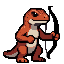
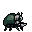
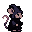

# Underbrush Kingdom

A phone-first web game about a band of tiny heroes living in the underbrush. Collect **Archer Lizards**, **Beetle Knights** and **Wizard Mice**, send them on expeditions, and turn the junk they bring home into weapons.

<p>
  
  
  
</p>

## How it plays

1. **Start small.** You begin with three fighters: one of each class.
2. **Expeditions.** Pick an expedition type. Each one has its own *demands*, meaning which classes its encounters favour:
   | Expedition | Favours | Mostly finds |
   |---|---|---|
   | Tangled Thicket | Archer Lizards | Stray twigs |
   | Old Gutter Drain | Beetle Knights | Bottle caps |
   | Glimmer Creek | Wizard Mice | Pebbles |
   | Windy Meadow | A mixed party | A bit of everything |
3. **Duration = encounters.** Choose 1–12 encounters, 10 minutes each (6 encounters = 1 hour). Results are revealed one encounter at a time. Later encounters are harder but give more. You can recall a party early and keep what they've already found.
4. **Workshops.** Put scrap into a workshop to smelt it into one material. Each family has 10 tiers:
   - Woodworker's Cabin: twigs → **woods** (Pine, Oak, Ashwood … Godwood)
   - The Forge: bottle caps → **metals** (Iron, Copper, Bronze … Godsbane)
   - Enchanter's Hut: pebbles → **crystals** (Quartz, Amethyst, Garnet … Prismheart)

   A batch holds up to 3 pieces of scrap. Each scrap has a **value**, and the batch's total value sets the odds. Tier 1 is always the likeliest, and more value makes rarer tiers likelier. Each scrap also has a highest tier it can ever reach; bottle caps, twigs and pebbles top out at tier 4. With 3 bottle caps the odds are about 50% Iron, 35% Copper, 12% Bronze and 2% Steel. The workshop shows the odds before you commit, and the result is revealed when the batch finishes. Materials you haven't found yet show as "?".
5. **Craft weapons.** A weapon takes 3 of one material: a Pine Bow, a Steel Sword, an Amethyst Staff. Its power comes from the material's tier. Equip one to raise a fighter's power…
6. **…or lure a recruit.** Leave a weapon at the **Lure Post** and, after a while, a new fighter of that class wanders in to claim it.

Fighters gain XP for every encounter their party wins, and level up over time.

At the top of the Camp tab, any fighter not away on an expedition wanders a grassy clearing ringed by trees. They squish and stretch as they go. Tap one to open their details. The trees and grass are drawn in code, so there are no image files for them.

## Project layout

```
index.html            App shell
css/style.css         Styles (mobile-first, pixel-art friendly)
js/data.js            All game data and balance numbers
js/game.js            Pure game logic (no DOM), unit tested
js/main.js            UI rendering and input
js/scene.js           Camp scene: forest clearing where idle fighters wander
js/sprites.js         Draws fighters: body + gear pieces joined at anchor points
sw.js                 Service worker for offline play / install
manifest.webmanifest  PWA manifest ("Add to Home Screen")
assets/sprites/       sprites.json (all character art) + generated PNG previews
assets/items/         16×16 item icons
assets/source/        Original art: high-res and 64×64 16-bit versions (not deployed)
tools/                Scripts used to make the art assets
tests/                Node tests for js/game.js
```

There's no build step. It's plain HTML, CSS and ES modules.

## Running locally

```bash
npm start
```

Then open http://localhost:8000. Add `?speed=60` to the URL to make all timers 60× faster while testing.

```bash
npm test
```

## Deploying to GitHub Pages

`.github/workflows/pages.yml` runs the tests and deploys the site on every push to `main`. To turn it on once, go to **Settings → Pages → Build and deployment → Source** and pick **GitHub Actions**.

## Sprite Workshop

Character art is edited in the **[Sprite Workshop](https://claude.ai/artifact/SGtaz1YMDs5cTKcVrUjBFR)**, a pixel editor that saves to shared storage. Its source is `tools/sprite-workshop.html`.

- **Bodies** (one per class) have named **anchor points**: `hand`, `offhand`, `head`, `chest`, `back`, or any name you add.
- **Gear pieces** (weapons, armour, hats) say which anchor they attach to and which pixel is their **pivot**. The game draws each piece so its pivot sits on the anchor, in front of or behind the body.
- Weapon art is chosen by material. A piece named `sword-steel`, `bow-oak` or `staff-garnet` gives that material its own look. Otherwise `sword-1`, `sword-2` and `sword-3` cover material tiers 1–3, 4–6 and 7–10 (the same goes for bows and staffs). Tick **Always worn by** to make a piece part of a class's default look, such as the beetle's armour. An equipped weapon replaces an always-worn piece in the same slot.
- When you're happy with the art, press **Send to game**, then ask Claude to sync the sprites. You can also download `sprites.json` from the workshop and replace `assets/sprites/sprites.json` yourself.

## Art pipeline

- `tools/downscale_sprite.py` turns the upscaled sprite art in `assets/source/` back into true 1:1, 64×64 pixel sprites. Each 7×7 block becomes one pixel, and the white background is made transparent.
  `python3 tools/downscale_sprite.py <in.png> <out.png> <grid-x-offset> <grid-y-offset>`
- `tools/make_8bit_sprites.py` makes the 32×32 8-bit game sprites from the 64×64 versions. It halves the resolution, cuts each sprite to a 10-colour palette, and mirrors the beetle so all three face right.
- `tools/sync_sprites.py` builds `sprites.json` from the workshop's saved data and regenerates the PNG previews and app icons.
- `tools/make_item_icons.py` regenerates the item icons and app icons.

When you ship changes, bump `CACHE` in `sw.js` so installed copies update.
